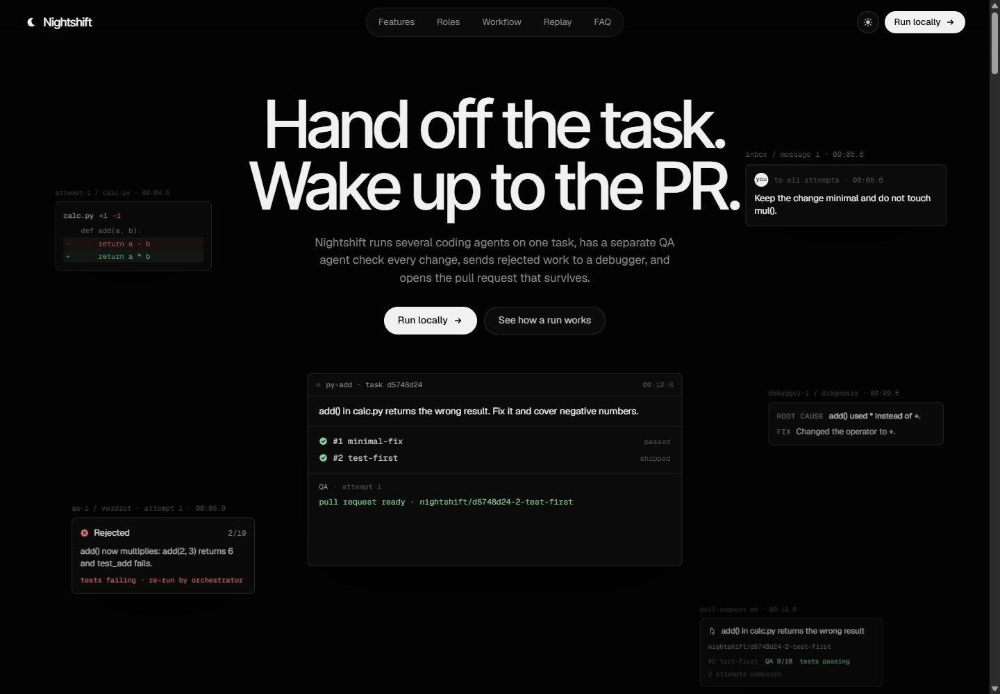
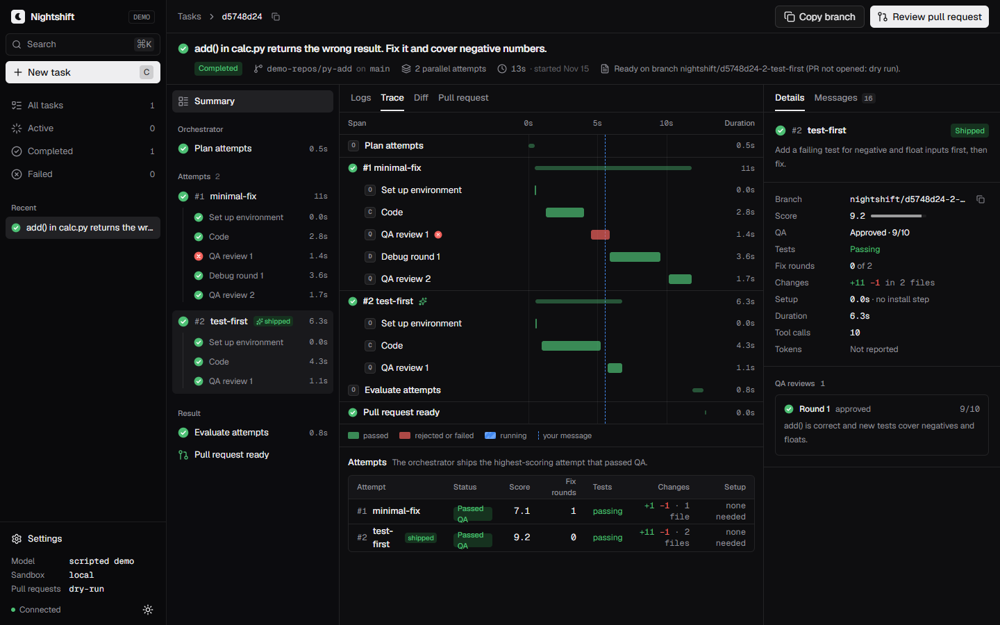
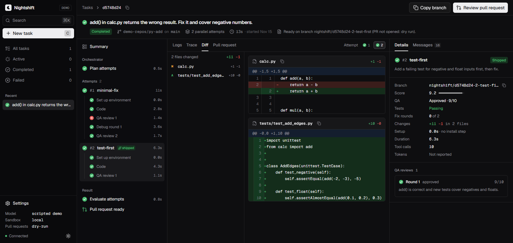
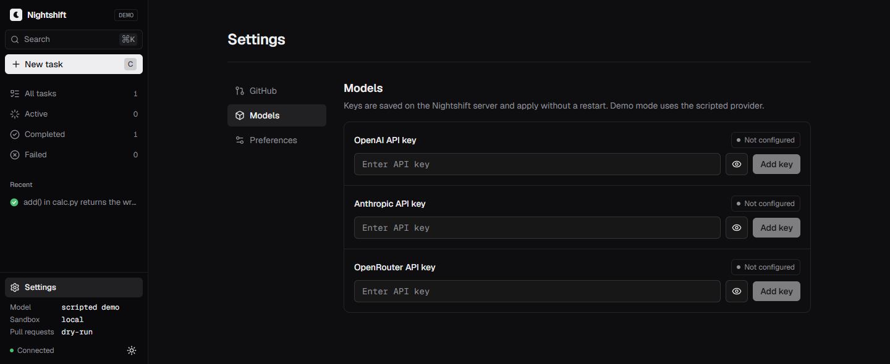

# Nightshift

A self-hosted background coding agent. Give it a bug or a small feature, compare the approaches it tries in parallel, and come back to a reviewed pull request.

[Live homepage](https://nightshift-showcase-osunmo-3bf53f3c4201.herokuapp.com/) · [Quick start](#quick-start) · [How it works](#how-it-works) · [Settings](#settings) · [Architecture and deployment](docs/architecture.md)





*Recorded demo showing two parallel attempts, a QA rejection and repair, and the selected result.*

## How it works

1. **Describe a task.** Choose a repository, base branch, and how many approaches to try.
2. **Run attempts in parallel.** Each coder gets its own Git branch, worktree, and sandbox. You can follow the logs and steer an attempt while it runs.
3. **Review and repair.** A separate QA agent reviews the diff and runs the tests. A debugger can repair a failed attempt, which goes through QA again.
4. **Ship the result.** Nightshift compares the attempts that pass, selects a winner, and can open a draft pull request. You can also inspect the diff and select another attempt.



## Quick start

Requires Node.js 22.13+ and Git. Docker and Kubernetes are optional.

```bash
git clone https://github.com/osunmo/NightShift.git
cd NightShift
npm install
npm run demo
```

Open [http://localhost:4100/app/](http://localhost:4100/app/) for the app. The demo uses a scripted model and sample repositories, so it needs no model API key. The [local homepage](http://localhost:4100/) includes a replay of a recorded run.

For your own repositories, build and start Nightshift, then configure a model and GitHub access from Settings.

```bash
npm run build:web
npm start
```

You can also start a run from the terminal.

```bash
npm run cli -- run --repo ./path/to/repo --no-pr "Fix the pagination off-by-one and add a regression test"
```

## Settings



- **GitHub** connects a GitHub App and lists the repositories in the selected installation. Nightshift uses short-lived, repository-scoped tokens to clone private repositories, push branches, and open PRs. [GitHub App setup](docs/architecture.md#github-app-repository-access)
- **Models** accepts OpenAI, Anthropic, and OpenRouter API keys and encrypts keys saved through the UI. Server environment variables also work, and Ollama is available for local models. [Model configuration](docs/architecture.md#configuration)
- **Preferences** controls automatic draft PRs and agent rules for new tasks started from the browser.

## Host the homepage

The public showcase serves the landing page and its recorded demo. It runs without API keys or a database. The repository includes a Heroku `Procfile` and builds the showcase automatically on deploy. Connect the GitHub repository to an existing Heroku app, then deploy `main`. To preview the same build locally, run `npm run build:showcase` and `node web/serve-showcase.mjs`.

## Engineering notes

Nightshift uses a TypeScript server, React web app, and SQLite event log. The orchestrator can resume unfinished runs from the event log and existing worktrees. Container and pod sandboxes can be recreated after interruption, and checkpoints preserve attempt progress.

[Architecture](docs/architecture.md#components) · [Recovery](docs/architecture.md#recovery) · [Evaluation](docs/architecture.md#measuring-it) · [Tests](docs/architecture.md#tests)

## License

[MIT](LICENSE)
